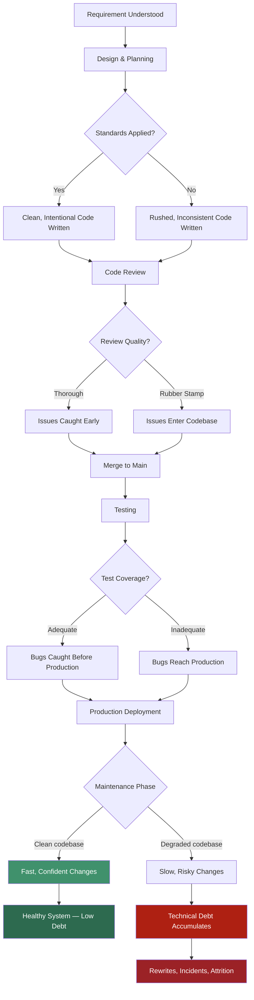

# 00 — Introduction to Engineering Standards

> *"Any fool can write code that a computer can understand. Good programmers write code that humans can understand."*
> — Martin Fowler

---

## Table of Contents

1. [What Are Engineering Standards?](#1-what-are-engineering-standards)
2. [Why Coding Standards Matter](#2-why-coding-standards-matter)
3. [The Cost of Poor-Quality Code](#3-the-cost-of-poor-quality-code)
4. [How Standards Enable Professional Engineering](#4-how-standards-enable-professional-engineering)
5. [Amalitech Engineering Expectations](#5-amalitech-engineering-expectations)
6. [How to Use This Repository Effectively](#6-how-to-use-this-repository-effectively)
7. [Applying Standards in Daily Development](#7-applying-standards-in-daily-development)
8. [The Mindset of a Professional Engineer](#8-the-mindset-of-a-professional-engineer)
9. [The Lifecycle of Code Quality](#9-the-lifecycle-of-code-quality)

---

## 1. What Are Engineering Standards?

Engineering standards are agreed-upon rules, conventions, and practices that a team follows when designing, writing, testing, and maintaining software. They are not arbitrary restrictions — they are the distilled experience of engineers who learned, often painfully, what makes software systems easy to build, extend, and operate.

Standards operate at several levels:

| Level | Examples |
|-------|----------|
| **Formatting** | Indentation, line length, brace placement |
| **Naming** | Variable names, class names, method names |
| **Structure** | Package layout, class design, method length |
| **Process** | Branching strategy, commit messages, code review |
| **Quality gates** | Test coverage thresholds, static analysis rules |
| **Security** | No hardcoded credentials, input validation requirements |

A standard is only useful if it is:
- **Written down** — so it can be referenced and not misremembered.
- **Consistently applied** — so the codebase looks like it was written by one team, not ten individuals.
- **Understood, not just followed** — engineers who understand *why* a standard exists apply it intelligently and adapt it when the context genuinely requires a different approach.

---

## 2. Why Coding Standards Matter

### 2.1 Consistency

A consistent codebase is predictable. When every class follows the same structural pattern, every method follows the same naming scheme, and every commit message follows the same format, engineers can navigate the codebase without having to context-switch into each contributor's personal style.

Consider this contrast:

```java
// Developer A's style
public class userService {
    public List getAll(){ return repo.findAll(); }
}

// Developer B's style
public class UserService {
    public List<User> getAllUsers() {
        return userRepository.findAll();
    }
}
```

The second example follows standard Java conventions. If the whole codebase looks like Developer B's work, any engineer can read any file without friction.

### 2.2 Readability

Code is read far more often than it is written. A typical feature involves reading ten times as much existing code as you write. Readable code reduces the mental load of that reading, so engineers spend their cognitive energy on the actual problem, not on decoding the code.

### 2.3 Maintainability

Software lives long. A system written in 2020 will often be maintained until 2030 or beyond. The engineers maintaining it in 2028 may not be the ones who wrote it. Code that is well-structured and clearly named is cheap to maintain. Code that is clever, compressed, or inconsistent is expensive.

### 2.4 Onboarding

When a new engineer joins the team, their first task is understanding the codebase. A repository with clear standards, consistent patterns, and good documentation can be understood in days. One without standards may take months — during which the new engineer is unproductive and frustrated.

### 2.5 Teamwork

Standards are a contract between team members. When you follow them, you signal respect for your colleagues' time. Code reviews become faster because reviewers are not debating style — they are evaluating logic and correctness.

### 2.6 Reduced Bugs

Many bugs are introduced by misunderstanding. Clear naming and structure make the intent of code obvious, which reduces the chance of a future change introducing a defect through misinterpretation.

---

## 3. The Cost of Poor-Quality Code

Poor-quality code creates **technical debt** — work deferred today that must be paid back (with interest) tomorrow.

### 3.1 Technical Debt Compounds

A small shortcut taken in a core module spreads. Other code is built on top of it. When the shortcut eventually must be corrected, the fix is not isolated — it touches everything built on the original mistake.

### 3.2 Higher Bug Rates

Code that is hard to understand is code that is easy to break incorrectly. When a developer cannot clearly see what a method does, they are more likely to call it in the wrong context, pass the wrong arguments, or ignore an error case.

### 3.3 Developer Frustration and Attrition

Engineers who spend their days fighting a messy codebase are demoralised. The frustration of not being able to make a small change without breaking something, or spending hours understanding code that should take minutes, is a significant contributor to burnout and turnover.

### 3.4 Slower Delivery

Teams often believe that cutting corners speeds up delivery. In the short term, it does. After six months, the accumulated debt means every new feature takes three times as long to implement because the engineer must first understand and work around the existing mess.

### 3.5 Real Cost Estimate

Research by the CAST Research Lab found that the average technical debt in enterprise software is **$3.61 per line of code**. For a 500,000-line system, that is $1.8 million in debt. The same research found that poor-quality code is responsible for **approximately 23% of IT project failures**.

---

## 4. How Standards Enable Professional Engineering

Professional engineering is not about writing the most sophisticated algorithm. It is about delivering reliable software that solves real problems, can be operated safely in production, and can be extended by any engineer on the team.

Standards contribute to each of these:

**Reliability** — Consistent error handling and input validation patterns mean fewer unhandled edge cases reach production.

**Operability** — Logging and monitoring conventions mean that when something goes wrong at 2 AM, the on-call engineer can find the problem.

**Extensibility** — SOLID principles and clean structure mean that adding a new feature does not require rewriting existing code.

**Reviewability** — Commit conventions and PR practices mean that every change is traceable, understandable, and reversible.

Standards also provide a foundation for automation. Static analysis tools, linters, and CI pipelines can enforce many standards automatically, freeing engineers to focus their attention on the parts of a review that require human judgment.

---

## 5. Amalitech Engineering Expectations

> ⚠️ **Pending official Amalitech source.** The content below reflects general professional expectations for software engineers. Official Amalitech-specific requirements will be documented in [Section 11](../11-official-amalitech-reference/README.md) once the official Amalitech Engineering Standards PDF is provided.

Amalitech engineers are expected to operate at a professional level from day one. This means:

- Writing code that your teammates can read and understand without explanation.
- Naming variables, methods, and classes precisely and consistently.
- Writing tests that verify behaviour, not just execute code paths.
- Committing small, focused changes with clear commit messages.
- Reviewing others' code thoughtfully and constructively.
- Raising concerns about code quality or design decisions early, not after the problem is embedded in production.
- Treating the codebase as a shared resource, not personal territory.

The standard is not perfection on the first attempt. It is the consistent application of good judgment, combined with willingness to learn from feedback and improve.

---

## 6. How to Use This Repository Effectively

### As a learning tool

Read each section in order (00 through 10). Do not just read — apply. After reading Section 01 on Clean Code, go into your current project and find one example of each code smell described. Rename one poorly-named variable. Refactor one method that is too long.

### As a daily reference

Bookmark this repository. When you are unsure whether a name is good, whether a method is too long, or how to format a commit message, come here first.

### As a team contract

When a code review comment references a standard, link to the relevant section in this repository. This keeps reviews objective and educational rather than personal.

### As a living document

Standards evolve. If you find that a standard no longer fits your context, or if you discover a better pattern, open a pull request proposing the change. Include your reasoning. The best standards are the ones the team actually understands and agrees with.

---

## 7. Applying Standards in Daily Development

Standards are habits. They are not useful if you remember them once a month during a team retrospective — they must be applied continuously, without thinking.

### Build the habit incrementally

Do not try to apply every standard at once. Pick one area — for example, naming conventions — and focus on it for a week. Rename things as you work. After a week, it becomes natural. Then add another focus area.

### Use tooling to enforce what you should not have to think about

Configure your IDE with the team's code style settings. Enable static analysis (Checkstyle, SpotBugs, SonarLint). Run the checks before every commit. Let the tools catch the mechanical issues so your mental energy goes to the substantive ones.

### Use the checklists

Before committing, run through the [pre-commit checklist](../10-engineering-checklists/README.md). Before submitting a PR, run through the PR checklist. Before approving a review, run through the code review checklist. These checklists take two minutes and prevent hours of post-merge cleanup.

### Treat review feedback as learning

When a reviewer asks you to rename a variable or split a method, do not take it personally. They are helping you apply the team's standards. Ask why if you do not understand the feedback. The goal is to understand the principle, not just to satisfy the comment.

---

## 8. The Mindset of a Professional Engineer

The most important shift that separates a good engineer from a great one is **writing code for the next developer, not just for the compiler**.

The compiler does not care about your variable names. It does not care if your method is 300 lines long or three. It does not care if your class does fifteen unrelated things. All it needs is syntactically valid code that it can compile.

The next developer — who might be you in six months, or a colleague who has never seen this code — needs to understand what the code does, why it does it, and how to safely change it. That developer's time, frustration, and success depend on the choices you make today.

**Write code as if the next person to read it is a capable engineer who has never seen this codebase.** Make the intent obvious. Make the structure predictable. Make the edge cases visible. Leave the code better than you found it.

This is the professional engineering mindset. It is not idealism — it is pragmatism. Code written with this mindset is cheaper to maintain, faster to extend, and safer to operate than code written purely to satisfy the compiler.

---

## 9. The Lifecycle of Code Quality

The diagram below shows how code quality decisions made at each phase of development accumulate into either a healthy or degraded system over time.



The diagram illustrates a critical point: **quality decisions compound**. A clean design, a thorough review, and adequate test coverage each individually improve the outcome. Together, they create a healthy system. Skip any one of them consistently, and the degradation is not linear — it accelerates.

---

*Next section: [01 — Clean Code](../01-clean-code/README.md)*
